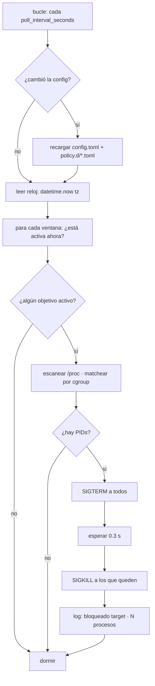

# Flujo de enforcement

Una pasada del daemon, de principio a fin.

## Qué mirar en cada paso

| Paso | Archivo | Qué decide |
|---|---|---|
| ¿cambió la config? | `daemon.py` (`fingerprint`) | recargar sin reiniciar el servicio |
| ¿ventana activa? | `core/scheduler.py` | `days` + `start`/`end`, con cruce de medianoche |
| ¿es el objetivo? | `core/matcher.py` | `cgroup_match` (y `cmdline_match` opcional) |
| matar | `enforcers/kill.py` | `SIGTERM` → gracia → `SIGKILL` |

## Por qué dos señales

`SIGTERM` deja que la app cierre archivos; el `SIGKILL` posterior garantiza que no quede
nada vivo si ignora el `TERM`. Matar solo el líder NO basta en un Flatpak (hay `bwrap`): por
eso se recalcula el conjunto antes del `SIGKILL`.
